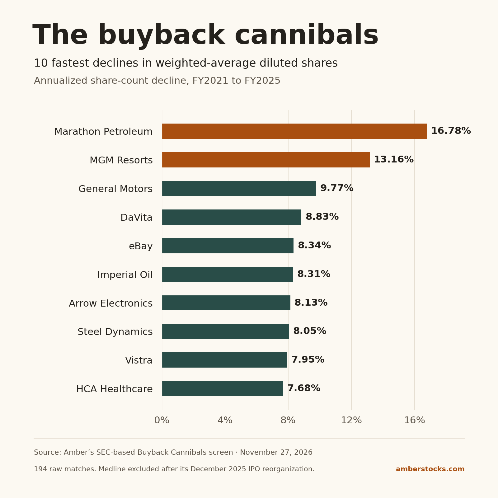

# The buyback cannibals shrinking their share counts fastest

Marathon Petroleum spent **$3.4 billion** repurchasing shares in fiscal 2025. General Motors spent **$6.0 billion**. Across the four years through fiscal 2025, Marathon’s weighted-average diluted share count fell **52%**, from **638 million to 306 million**. GM’s fell **34%**, from about **1.47 billion to 973 million**. Marathon led Amber’s ranking at **16.78% a year** after excluding Medline’s IPO-year comparison. [Marathon FY2021 10-K](https://www.sec.gov/Archives/edgar/data/1510295/000151029522000011/mpc-20211231.htm) · [Marathon FY2025 10-K](https://www.sec.gov/Archives/edgar/data/1510295/000151029526000009/mpc-20251231.htm) · [GM FY2021 10-K](https://www.sec.gov/Archives/edgar/data/1467858/000146785822000034/gm-20211231.htm) · [GM FY2025 10-K](https://www.sec.gov/Archives/edgar/data/1467858/000146785826000013/gm-20251231.htm)

| Rank | Company | FY2021 diluted shares | FY2025 diluted shares | Annual change | Four-year change |
| ---: | --- | ---: | ---: | ---: | ---: |
| 1 | [Marathon Petroleum (MPC)](https://amberstocks.com/t/MPC/sbc) | 638M | 306M | −16.78% | −52.0% |
| 2 | [MGM Resorts (MGM)](https://amberstocks.com/t/MGM/sbc) | 487M | 277M | −13.16% | −43.1% |
| 3 | [General Motors (GM)](https://amberstocks.com/t/GM/sbc) | 1,468M | 973M | −9.77% | −33.7% |
| 4 | [DaVita (DVA)](https://amberstocks.com/t/DVA/sbc) | 110M | 76M | −8.83% | −30.9% |
| 5 | [eBay (EBAY)](https://amberstocks.com/t/EBAY/sbc) | 663M | 468M | −8.34% | −29.4% |
| 6 | [Imperial Oil (IMO)](https://amberstocks.com/t/IMO/sbc) | 713M | 504M | −8.31% | −29.3% |
| 7 | [Arrow Electronics (ARW)](https://amberstocks.com/t/ARW/sbc) | 73M | 52M | −8.13% | −28.8% |
| 8 | [Steel Dynamics (STLD)](https://amberstocks.com/t/STLD/sbc) | 207M | 148M | −8.05% | −28.5% |
| 9 | [Vistra (VST)](https://amberstocks.com/t/VST/sbc) | 482M | 346M | −7.95% | −28.2% |
| 10 | [HCA Healthcare (HCA)](https://amberstocks.com/t/HCA/sbc) | 329M | 239M | −7.68% | −27.4% |

All ten reported a lower weighted-average diluted share count in each of the four annual comparisons. MGM Resorts ranked second, falling from **487 million to 277 million**. Marathon’s own repurchase spending varied substantially. It announced a **$10 billion** buyback plan after closing its **$21 billion** Speedway sale in 2021 and reported **$11.6 billion** of repurchases in 2023. A multi-year share count shows the cumulative effect of programs funded and executed at different times. [MGM FY2021 10-K](https://www.sec.gov/Archives/edgar/data/789570/000078957022000005/mgm-20211231.htm) · [MGM FY2025 10-K](https://www.sec.gov/Archives/edgar/data/789570/000078957026000018/mgm-20251231.htm) · [Marathon Speedway sale announcement](https://www.sec.gov/Archives/edgar/data/1510295/000151029521000078/ex991pressreleasemay14.htm) · [Marathon FY2025 10-K](https://www.sec.gov/Archives/edgar/data/1510295/000151029526000009/mpc-20251231.htm)

### How we measured it

Amber’s live Buyback Cannibals screen returned **194 matches** on November 27, 2026. It requires at least **$500 million in revenue**, positive free cash flow after stock-based compensation, and an annualized diluted share-count decline of at least **1.5%**. It excludes financial institutions and REITs. The ten companies shown all have five full fiscal-year observations from FY2021 through FY2025. The ranking uses the compound annual change between the two endpoints, calculated from Amber’s share figures in millions. Weighted-average diluted shares are the denominator used for diluted EPS and reflect share issuances and potential dilution as well as buybacks. [Live Amber screen](https://amberstocks.com/lenses/buyback-cannibals)

We excluded Medline, the raw screen’s top row. Its FY2025 filing calculates the weighted-average Class A count over the period following its December 2025 reorganization and IPO. That provides a different share base from the predecessor figures used earlier in Amber’s series. [Medline FY2025 10-K](https://www.sec.gov/Archives/edgar/data/2046386/000204638626000009/mdln-20251231.htm)
