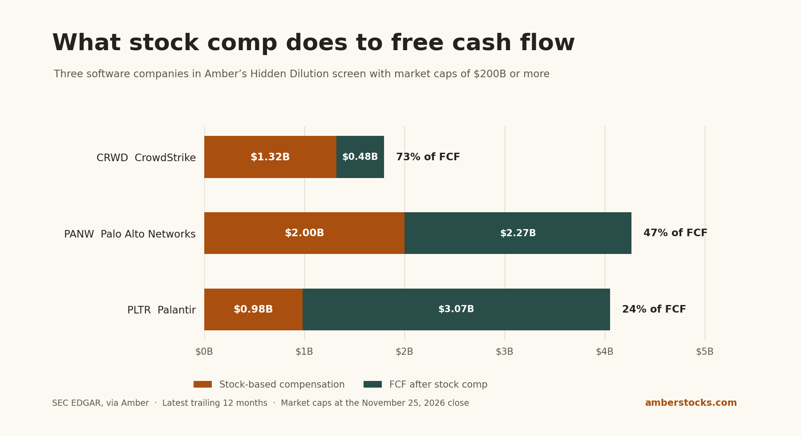

# What happens to free cash flow after stock comp at three $200B-plus software companies?

CrowdStrike generated **$1.80 billion** of trailing free cash flow. It also recorded **$1.32 billion** of stock-based compensation over the same period. Subtract the second figure from the first and the remainder is **$477 million**, or **8.3% of revenue**. Palo Alto Networks and Palantir pass the same high-SBC screen, but the adjustment tells a different story at each company. [CrowdStrike cash-flow bridge](https://amberstocks.com/t/CRWD/sbc)

| Company | FCF before SBC | SBC | FCF after SBC | SBC / FCF | After-SBC FCF margin |
| --- | ---: | ---: | ---: | ---: | ---: |
| CrowdStrike (CRWD) | $1.80B | $1.32B | $0.48B | 73% | 8.3% |
| Palo Alto Networks (PANW) | $4.27B | $2.00B | $2.27B | 47% | 18.2% |
| Palantir (PLTR) | $4.05B | $0.98B | $3.07B | 24% | 42.2% |

Palo Alto had the largest stock-comp expense in dollars. CrowdStrike had the largest expense relative to its cash flow. Palantir retained the highest after-SBC margin of the three, while its diluted share count grew about **7.5% annually** in Amber’s four-year comparison, versus **6.6%** at Palo Alto and **2.5%** at CrowdStrike. I’d look at both figures when asking how much of a company’s cash-flow growth reaches each share. [Side-by-side comparison](https://amberstocks.com/compare/CRWD-vs-PANW-vs-PLTR)

I pulled this screen from Amber on November 27, 2026. It covers the three companies in its Hidden Dilution lens with at least **$200 billion** in market cap using November 25 closes. The lens screens by **SBC as a share of revenue**. The table ranks those matches by **SBC as a share of FCF**. The financials cover the trailing twelve months from each company’s latest available filing. Amber calculates FCF as operating cash flow minus capital expenditures and True FCF as FCF minus reported SBC. SBC is a noncash expense and the subtraction shows the cost of equity compensation in the comparison. The diluted share-count trend measures a separate effect. [Live screen](https://amberstocks.com/lenses/hidden-dilution) · [CrowdStrike 10-Q](https://www.sec.gov/Archives/edgar/data/1535527/000153552726000038/0001535527-26-000038-index.htm) · [Palo Alto Networks 10-Q](https://www.sec.gov/Archives/edgar/data/1327567/000132756726000033/0001327567-26-000033-index.htm) · [Palantir 10-Q](https://www.sec.gov/Archives/edgar/data/1321655/000132165526000048/0001321655-26-000048-index.htm)
